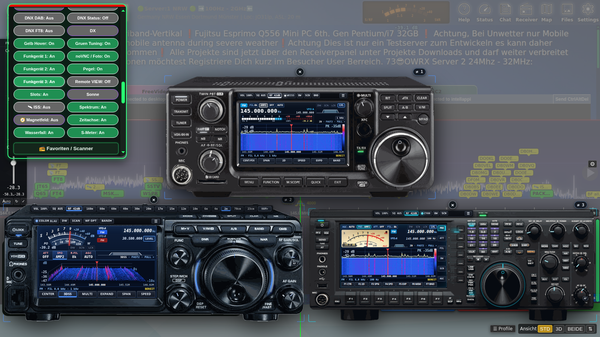

# DNX HF-Funkgeräte Remote (`v1.1.0`)

<!-- DNX-DISCLAIMER-START -->
> **Wichtiger Hinweis / Vollständige Distanzierung (Hobby-Mod-Mode)**
>
> - **Vollständige Distanzierung:** Ich distanziere mich in jeder Hinsicht vollständig vom Projekt **OpenWebRX / OpenWebRX+** sowie dessen Entwicklern und Betreibern. Es besteht keinerlei Verbindung, Zusammenarbeit, Prüfung, Befürwortung oder Partnerschaft.
> - **Keine öffentlichen/offiziellen OpenWebRX-Plugins (nur Mod-Mode):** Bei diesem Projekt handelt es sich ausdrücklich **nicht** um ein öffentliches oder offizielles Plugin von OpenWebRX, sondern ausschließlich um einen privaten, inoffiziellen **Mod-Mode** (Eigenmodifikation).
> - **Warum bewusst kein reines Browser-JavaScript (Mod-Mode-Architektur):** Viele Funktionen (z. B. serverseitige Speicherung, Konten-/Rollenverwaltung, Profil-Synchronisation, VNC-/websockify-Brücken, geschützte Schnittstellen, Docker-/Systemintegration und stabile UI-Anpassungen) lassen sich sauber und sicher nicht allein über simples Client-JavaScript umsetzen, ohne den OpenWebRX-Kern umzubauen oder Browsergrenzen zu umgehen. Deshalb setzt dieses Projekt bewusst auf getrennte Begleitmodule, Shell-Installer und Dienste im **Mod-Mode** statt alles künstlich in reines JavaScript zu pressen.
> - **Kein öffentlicher Support & keine Haftung:** Es gibt **keinen öffentlichen Support**, keine Garantie und keine Haftung. Nutzung, Installation und Anpassung erfolgen vollständig auf eigene Gefahr (immer vorher Backups anlegen und zunächst im eigenen Testsystem prüfen).
> - **Reines Hobbyprojekt – frei nutzbar, änderbar & verbreitbar:** Dieses Projekt entsteht ausschließlich aus reinem Hobby und Interesse am gemeinsamen Funk-/SDR-Hobby. Es steht ausdrücklich frei zur Verfügung und darf frei genutzt, weiterverbreitet, verändert und verbessert werden.
<!-- DNX-DISCLAIMER-END -->

> **Important Notice / Full Disassociation (Hobby Mod-Mode Only)**
>
> - **Full Disassociation:** I completely disassociate myself from **OpenWebRX / OpenWebRX+** and its developers/maintainers. There is no affiliation, endorsement, review, or partnership of any kind.
> - **No Official/Public OpenWebRX Plugins (Mod-Mode Only):** These files are **not** official or public OpenWebRX plugins, but purely unofficial hobby modifications (*mod-mode*).
> - **Why Not Everything in Pure Browser JavaScript:** Many features (server-side persistence, account/role management, profile syncing, VNC/websockify bridges, protected endpoints, and Docker/host integration) cannot be implemented cleanly or reliably in client-side JavaScript alone without modifying the OpenWebRX core or hitting browser/security limits. That is why this project intentionally uses separate companion scripts, services, and *mod-mode* hooks rather than forcing everything into pure JS.
> - **No Public Support & No Warranty:** There is **no public support**, no warranty, and no liability. Use entirely at your own risk.
> - **Pure Hobby Project — Free to Use, Modify & Redistribute:** Created solely out of personal hobby interest in the shared radio/SDR hobby; freely available to use, share, modify, and improve.

<!-- DNX-PREVIEW-START -->
## Live-Vorschau / Live Preview


<!-- DNX-PREVIEW-END -->

Drei voll bedienbare, markenfreie Kurzwellen-/Allmode-Transceiver als schwebende Fernsteuerung direkt über OpenWebRX / OpenWebRX+ — **komplett mit allen drei hochauflösenden, markenfreien Frontplatten-Grafiken** in einem eigenständigen Installationspaket.

## Neu in v1.1.0 (`dnx_funkgeraete.js v8.24`)

- **NEU: Funkgerät 3 (Touch-Konsole `1240×564`, skalierbar auf `720×327`):**
  - Markenfreie Direct-Sampling-SDR-Frontplatte (`funkgeraet3_ic7300_v824.png`) mit 32-Segment-S-Meter + Spitzenwert-Halteanzeige, Live-Spektrum/Wasserfall (`2D` / `3D (3DSS)` / `MULTI`), `CENT/FIX` · `SPAN` · `SPEED` · `EXPD` · `BAND` und `7` Touch-Inline-Popovers (`Level`, `Scope/Wasserfall`, `Band`, `Mode`, `Speicher`, `Step`, `10er-Direktfrequenzpad`).
  - Dual-Concentric-Drehregler (`AF GAIN` innen, `RF/SQL` außen), `TWIN PBT` + `CLR`, `MULTI` + `VFO`-Hauptabstimmrad mit wählbarer Akzentfarbe (`color3`), `POWER` (`Shift+Klick` dimmt Display), `XFC`, `AUTO TUNE`, `SPEECH/TON`, `RIT`, `SPLIT`, `A/B`, `CLEAR` und aktive `RX/PWR`-LEDs.
  - Kollisionsfreie Aufstellung im 3-Geräte-Desktop (zentriert über Gerät `1 + 2`) oder Solo-Wechsel `⇄ 1 / ⇄ 2 / ⇄ 3`.

## Enthaltene Geräte & Funktionen (`dnx_funkgeraete.js v8.24`)

- **Funkgerät 1 (links):** Markenfreies Allmode-Pultgerät (`1126×440`) mit 3D-Spektrumstream/Wasserfall (`3DSS`, `MULTI`, `EXPAND`), Analog-/Digital-S-Meter + Spitzenwert-Halteanzeige, echten Bandtasten (`160m–23cm`), `VFO A/B`, `A/B`, `SPLIT`, `DW`, `SCAN`, `DSP`-Filtertasten (`NB`, `DNR`, `NAR`), `STEP/MCH`, `AF GAIN`, `RF GAIN/SQL` und großem Abstimmrad (`VFO`).
- **Funkgerät 2 (rechts):** Markenfreie Profi-HF-Frontplatte (`1196×468` mit feiner Gehäuseblende im `2×`-Modus) mit hochauflösendem Farbdisplay, Wasserfall/Spektrum (`F1 CTR` bis `F7 BND`), `PRE`/`ATT`/`AGC`, 10er-Direktfrequenzfeld (`1,8–50 MHz`), Betriebsarten (`LSB/USB`, `CW`, `FSK/PSK`, `FM/AM`, `DATA`), Echtzeit-Drehreglern (`AF`, `RF`, `SQL`, `NB`, `NR`, `IF-SHIFT`, `PBT`) und großem Abstimmrad.
- **Funkgerät 3 (Touch-Konsole):** Markenfreie Touch-Frontplatte (`1240×564`) mit 32-Segment-Digital-S-Meter, Live-Spektrum/Wasserfall (`2D / 3DSS / MULTI`), Dual-Concentric-Reglern (`AF / RF-SQL`), `TWIN PBT`, `MULTI` und 7 Inline-Touch-Menüs.
- **Echte OpenWebRX-Profil- & Empfängerbindung:** Liest automatisch `#openwebrx-sdr-profiles-listbox`, passt Abstimmwege innerhalb (`UI.setFrequency`) und außerhalb des Empfangsfensters (`UI.setOffsetFrequency` / Profilwechsel) an und erkennt Gast-Sperren (`403`) ehrlich ohne Fehlanzeige.
- **Eigenständig auf jedem OpenWebRX / OpenWebRX+:**
  - Erkennt optionalen `DNX Styler` automatisch (`Funkgerät 1 / 2 / 3`); ohne Styler erscheint automatisch ein eigener kompakter Umschalt-Knopf (`Funkgeräte`) zum Ein-/Ausblenden.
  - Nutzt `api/dnx-gain`, sofern serverseitig vorhanden; auf Systemen ohne Gain-API (`404`/`405`/`501`) arbeitet der RF-Gain-Regler sauber lokal ohne Fehlerpolling.

## Inhalt des Pakets

- `install.sh` — interaktiver Installer für **normale OpenWebRX-Installationen** und **Docker-Images / Docker-Container** (`Bind-Mount` & `docker cp`)
- `files/dnx_funkgeraete.js` — komplettes JavaScript-Modul (`v8.24`)
- `files/funkgeraet1_ft710_v8_113.png` — markenfreie Frontplatte Funkgerät 1
- `files/funkgeraet2_ts890_v822.png` — markenfreie Frontplatte Funkgerät 2 (`1196×468`)
- `files/funkgeraet3_ic7300_v824.png` — markenfreie Touch-Frontplatte Funkgerät 3 (`1240×564`)
- `SHA256SUMS.txt` — Prüfsummen aller Dateien
- `LICENSE` — MIT-Lizenz

## Installation

```bash
unzip DNX-HF-Funkgeraete-Remote-v1.1.0.zip
cd DNX-HF-Funkgeraete-Remote
chmod +x install.sh
sudo ./install.sh
```

Direktwahl ohne Rückfrage:

```bash
sudo TYP=normal PLUGINS=/usr/lib/python3/dist-packages/htdocs/plugins ./install.sh install
sudo TYP=docker CONTAINER=owrx-8013 ./install.sh install
./install.sh status
sudo ./install.sh update
sudo ./install.sh uninstall
```

## Rechtlicher Hinweis / Disclaimer

**DE:** Private, inoffizielle Hobby-Anpassung (Mod-Mode) für OpenWebRX / OpenWebRX+. Kein offizielles OpenWebRX- oder OpenWebRX+-Projekt, keine Verbindung zu oder Unterstützung durch die jeweiligen Entwickler. Nutzung erfolgt vollständig auf eigene Gefahr; soweit gesetzlich zulässig wird jede Haftung ausgeschlossen. Vor dem Einspielen bitte Sicherungen anlegen.

**EN:** Private, unofficial hobby modification (Mod-Mode) for OpenWebRX / OpenWebRX+. Not an official OpenWebRX or OpenWebRX+ project; no affiliation with or support from its maintainers. Use entirely at your own risk; to the extent permitted by law, no liability is accepted. Always create backups before installing.

---

## Verbindungen im DNX-Ökosystem


* **Verbindung zu `DNX-Styler` (`TOOL_DEFS` & `dnx_3dtool`):** Die 3 Kurzwellen-/Allmode-Transceiver lassen sich direkt über `t_funkgeraet1..3` in `#dnx-blk-tools` schalten; der Zustand liegt in `localStorage["dnx.fg.menu"]` / `dnx.fg.zustand3` und läuft sauber neben `dnx_3dtool` (`DNX-Integrated-Waterfall-3D`).
* **Verbindung zu `DNX-Receiver-Account-Control`:** Das Recht `tune` bzw. `other_tools` über `:8095/api/me` steuert die Bedienfreigabe pro Rolle.
